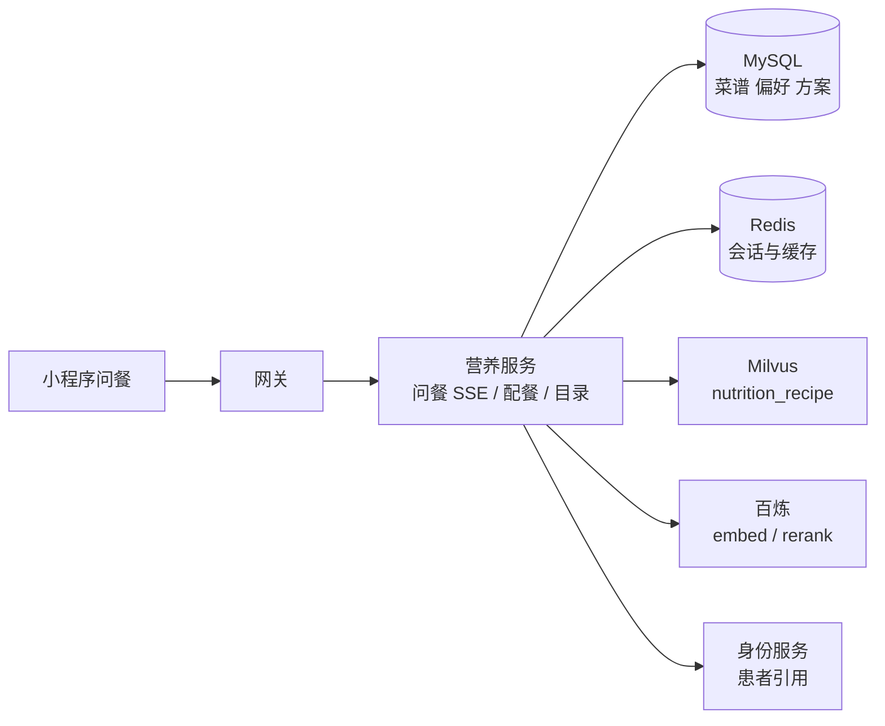
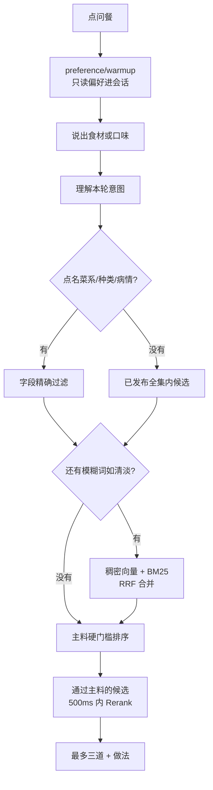

# 饮食方案

家里有什么菜、想减脂还是控糖，系统从**已发布菜谱**里挑最多三道能做的，给出做法。不临场编菜，不临场下病情结论。

本仓库是 [moonligh](https://moonligh.cn/) 的个人开源项目，采用 [Apache-2.0](LICENSE) 许可证。

## 三十秒看懂

1. 打开问餐。先把账号上已记下的口味、忌口预热进这一轮会话。
2. 报家里的食材，或说「川菜」「清淡一点」。点名菜系/种类/病情走字段过滤；「清淡」这类话才走向量和词检索。
3. 主料必须齐全才上榜，最多三道。缺的非常备辅料写成「需自备」。
4. 说「没有某某」就换菜；说「可以吃某某了」就改口。忌口进库不挡这一轮出菜。

克数和热量听已发布配料与求解器。模型不改克数，也不能把没标过的食材说成某种病可以吃。

## 现在做到哪

V0.1 软件主链路（患者绑定、画像/安全/目标、库存与确定性配餐、推荐 SSE、烹饪执行、偏差/解馋/评价、专业目标与 Kill Switch）已落地。在此之上，问餐对话与菜谱检索也已接上：

- 问餐：点按钮预热偏好 → SSE 回合 → 理解/规划/召回；记忆 LLM 异步写，不堵出菜。
- 检索：Milvus 稠密向量 +（库内 BM25 或进程内 BM25 降级）→ RRF 融合 → 主料硬过滤 → 百炼 Rerank（500ms 预算，超时保持规则序）。
- 点名菜系/病情过滤 miss 时 fail-closed，不退回全库乱推。
- 金标与 Accept 门禁已齐；合入 `master` / 打版前仍按放行清单做环境和压测。

账号、就诊人和网关鉴权与 `registration-assistant` 协作。统一返回、鉴权等脚手架在独立仓 `moonligh-platform`。本仓只保存患者引用和营养业务事实。

## 系统里有谁

患者小程序只敲网关。问餐与配餐落在营养服务；向量在 Milvus；嵌入与重排走百炼。



| 谁 | 干什么 | 端口 |
| --- | --- | --- |
| 网关 | 登录检查、限流、路由（挂号仓） | 8080 |
| 营养服务 | 问餐、推荐、目录、向量上传/重灌 | 18091 |
| 身份 | 登录与就诊人（挂号仓） | 18082 |
| Milvus | 已发布菜稠密向量；≥2.5 时库内 BM25 | 19530 |
| MySQL | 事实源：菜谱正文、chunk、偏好、方案 | — |

## 口述：从点「问餐」到三道菜

先记住：**推荐只使用已发布菜。** 没有合适的已发布菜，就老实说没有，不会另外编一道。



### 检索怎么分路

| 路径 | 何时用 | 说明 |
| --- | --- | --- |
| 标量 filter | 川菜、汤、减肥、控糖等 | 精确字段；miss 不降级乱推 |
| 稠密向量 | 「清淡一点」等对不上字段的话 | `search`，COSINE |
| BM25 | 同上 | 优先 Milvus `searchText`；库未就绪则进程内 chunk BM25 |
| 多路融合 | 向量与词都有结果 | RRF；有 filter 时词只在向量结果内重排 |
| Rerank | 主料已通过之后 | 百炼 `gte-rerank-v2`；超时/失败保持规则序 |

写入已发布菜时，正文进 Milvus `content`，稠密向量进 `embedding`。远端 Milvus 若仍是 2.3.x，建表会降级为「稠密 + content」，库内 BM25 等运维升到 **≥2.5** 后 drop + 重灌即可打开。

### 记忆怎么记

忌口、改口等规则写同步落库。口味类可由模型异步抽取，**失败不影响本轮出菜**，下一轮预热后再带上。绝对忌口仍走同步规则。

## 本地怎么跑

JDK 21，本机 MySQL 库 `nutritionist`，再加 Redis。密钥写在不进 git 的 `config/application-local.yml`（可对照 `application-local.example.yml`）。

```text
mvn -B -pl nutritionist-service -am test
mvn -B -pl nutritionist-service -am spring-boot:run
```

服务默认 `18091`。向量真库冒烟（可选）：

```text
mvn -pl nutritionist-service "-Dtest=RecipeVectorLiveSmokeIT" "-Drecipe.vector.smoke=true" test
```

Milvus 升到 2.5+ 并换新构建后，重建集合可调：

`POST /api/nutrition/catalog/vectors/reseed`（需 `Idempotency-Key`）

## 仓库里有什么

```text
nutritionist-api/          对外契约
nutritionist-service/      问餐、推荐、目录、向量索引
docs/方案                  食材推荐产品方案（权威）
docs/superpowers/specs/    问餐、记忆、检索设计
docs/superpowers/plans/    施工与放行清单
```

要对照源码时，从这些地方看起：

- `DialogueController` / 问餐 SSE：每一轮怎么走
- `DishRecommendService`：召回、主料门槛、Rerank
- `MilvusRecipeIndex` / `RecipeVectorUpload`：写入与重灌
- `HybridRecall` / `PassedRerank`：RRF 与超时预算
- `PreferenceWarmup` / 记忆写入：预热与异步不堵问餐

## 权威文档

- 食材推荐回合：[`docs/方案`](docs/方案)
- 问餐完整方案：[`docs/superpowers/specs/2026-11-18-问餐对话企业级完整方案-design.md`](docs/superpowers/specs/2026-11-18-问餐对话企业级完整方案-design.md)
- 上线验收线：[`docs/superpowers/specs/2026-11-18-问餐企业级上线验收线.md`](docs/superpowers/specs/2026-11-18-问餐企业级上线验收线.md)
- 产品基线：[`docs/superpowers/specs/2026-11-10-慢病与减重食材推荐系统设计.md`](docs/superpowers/specs/2026-11-10-慢病与减重食材推荐系统设计.md)
- V0.1 放行：[`docs/superpowers/plans/2026-11-10-V0.1放行检查清单.md`](docs/superpowers/plans/2026-11-10-V0.1放行检查清单.md)

## 还没接上的 / 运维收尾

- [x] V0.1 P0～P5 软件主链路
- [x] 问餐 warmup、SSE 门禁、记忆同步/异步拆分
- [x] 稠密检索、BM25 契约、RRF、百炼 Rerank、reseed
- [ ] Milvus 升到 ≥2.5 后 drop + 全量重灌（打开库内 BM25）
- [ ] 生产钥匙、真环境 Accept 冒烟与压测（放行清单）

## 声明

本项目提供的是饮食信息整理，不能替代营养师或医师的个体化医嘱。

## 参与贡献

贡献方式见 [CONTRIBUTING.md](CONTRIBUTING.md)，行为准则见 [CODE_OF_CONDUCT.md](CODE_OF_CONDUCT.md)。安全问题见 [SECURITY.md](SECURITY.md)，请不要把漏洞细节写进公开 Issue。

## 许可证

Copyright 2026 moonligh

本项目使用 Apache License 2.0，全文见 [LICENSE](LICENSE)。
